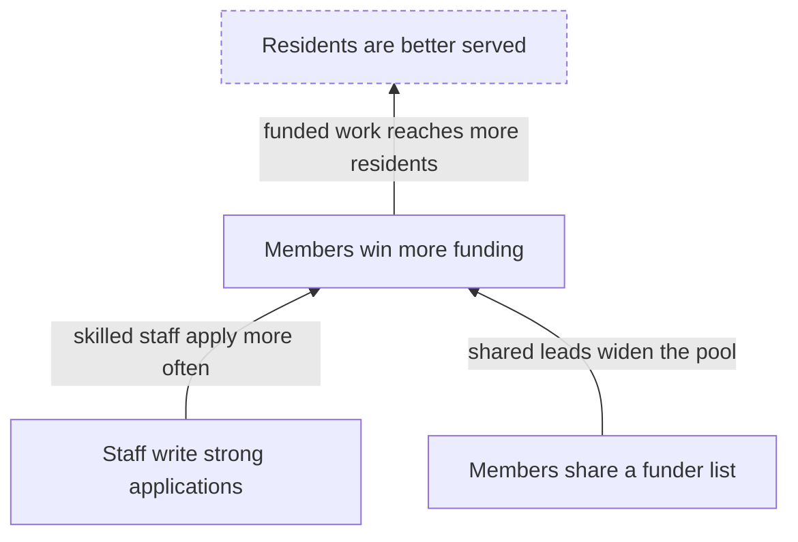
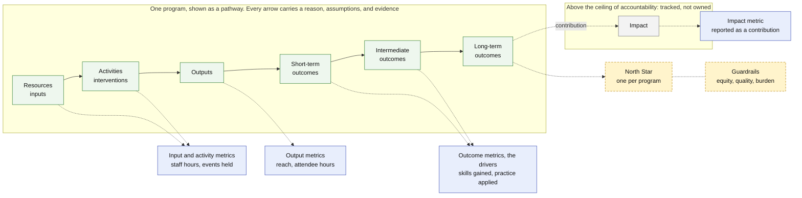
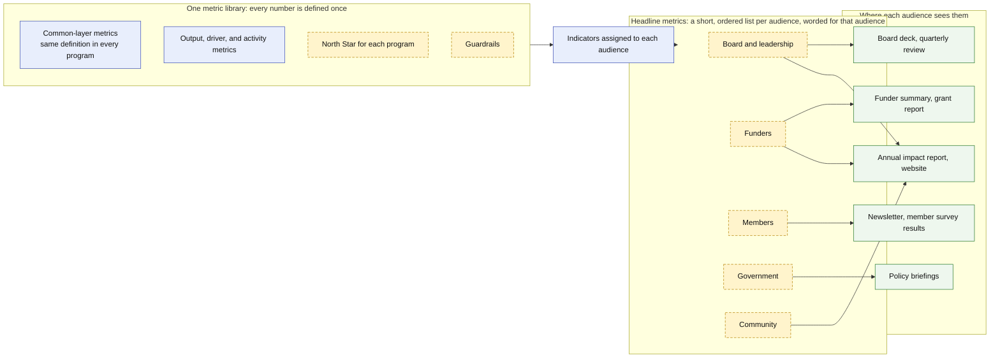

# Theory of Change Spec

[![Go CI][go-ci-svg]][go-ci-url]
[![Go Lint][go-lint-svg]][go-lint-url]
[![Go SAST][go-sast-svg]][go-sast-url]
[![Docs][docs-godoc-svg]][docs-godoc-url]
[![License][license-svg]][license-url]

 [go-ci-svg]: https://github.com/ProductBuildersHQ/theoryofchange-spec/actions/workflows/go-ci.yaml/badge.svg?branch=main
 [go-ci-url]: https://github.com/ProductBuildersHQ/theoryofchange-spec/actions/workflows/go-ci.yaml
 [go-lint-svg]: https://github.com/ProductBuildersHQ/theoryofchange-spec/actions/workflows/go-lint.yaml/badge.svg?branch=main
 [go-lint-url]: https://github.com/ProductBuildersHQ/theoryofchange-spec/actions/workflows/go-lint.yaml
 [go-sast-svg]: https://github.com/ProductBuildersHQ/theoryofchange-spec/actions/workflows/go-sast-codeql.yaml/badge.svg?branch=main
 [go-sast-url]: https://github.com/ProductBuildersHQ/theoryofchange-spec/actions/workflows/go-sast-codeql.yaml
 [docs-godoc-svg]: https://pkg.go.dev/badge/github.com/ProductBuildersHQ/theoryofchange-spec
 [docs-godoc-url]: https://pkg.go.dev/github.com/ProductBuildersHQ/theoryofchange-spec
 [license-svg]: https://img.shields.io/badge/license-MIT-blue.svg
 [license-url]: https://github.com/ProductBuildersHQ/theoryofchange-spec/blob/main/LICENSE

An AI-native, spec-driven way to capture, measure, and report on a
[Theory of Change](https://en.wikipedia.org/wiki/Theory_of_change):
a Go-first data model with generated JSON Schema, plus an SDK, the
`theoryofchange` CLI, and an MCP server.

> **Status:** the first release, v0.1.0, is prepared; see the
> [release notes](docs/releases/v0.1.0.md).

## What is a Theory of Change?

A Theory of Change explains **how and why a program expects to bring about a
change**. It starts from the long-term goal and works backwards: what
conditions must exist for the goal to be reached, what must exist before each of
those, and so on down to what the program does today. Each step is an
**outcome**; each arrow between outcomes is a **causal link** with a reason for
believing it holds; and each belief that has to be true for a link to work is an
**assumption** that can be tested.



An illustration only. The dashed outcome sits above the organization's **ceiling
of accountability**: the program tracks it and contributes to it, but does not
claim it.

### Why it matters

The method is used by foundations, development agencies, and funders, and the
sources agree on five reasons:

- **Planning.** Agree on what has to change, and in what order, before spending
  money on activities.
- **Closing the "missing middle".** Show how day-to-day activities connect to a
  long-term goal, instead of asserting that they do.
- **Evaluability.** Indicators and tests come from the theory, so you know what to
  measure and what would count as being wrong.
- **Communication.** Funders, partners, staff, and the people the program serves
  can see the same reasoning and argue with it.
- **Learning.** The theory is a living framework. When evidence arrives, you revise
  the theory instead of defending it.

### Pathways of change, outcome maps, and logic models

These are different **views of one theory**. Each answers a different question for
a different reader:

| View | Answers | What it looks like |
|------|---------|--------------------|
| **Pathway of change** | In what order must outcomes happen to reach the goal? | The chains of outcomes, from the earliest at the bottom to the long-term goal at the top. A program usually has several; together they are the *outcomes framework* |
| **Outcome map** | What changes, who is responsible for each change, and how is it measured? | The outcomes grouped by level, each with its sphere, whether the organization owns it or only monitors it, who delivers it, the cause it addresses, and the indicators that measure it |
| **Logic model** | What goes in, what is done, and what comes out? | Stages from inputs, activities, and outputs through short-term, intermediate, and long-term outcomes to impact, one model per pathway |
| **Logframe** | What do we promise, and how will we verify it? | A matrix of narrative, indicators with targets, means of verification, and assumptions, for contracts and monitoring |

A logic model or logframe is a *flattened* picture: it shows the sequence but
rarely why each step holds, and it cannot hold several pathways, feedback loops, or
the actors who are not you. You can generate a logic model from a Theory of
Change; you cannot recover the theory from a logic model. So this project keeps the
**theory as the source of truth** and produces every other view from it:

```bash
theoryofchange report pathway theory.yaml           # the pathways of change, as diagrams
theoryofchange report outcome-map theory.yaml       # the outcome map
theoryofchange report logic-model theory.yaml       # a logic model for each pathway
theoryofchange report logframe theory.yaml          # the logframe matrix
theoryofchange report definitions theory.yaml       # all of them, plus metrics and glossary
```

Change the theory once and every view changes with it, so the numbers and labels
never drift apart. (The outcome map here is the outcomes framework from the
ActKnowledge method; it is not IDRC's *Outcome Mapping*, which tracks progress
markers for the partners a program influences.)

### How the chain, the metrics, and what each audience sees fit together

A Theory of Change is the chain from resources to impact. Metrics hang off each step
of it, and different readers should see a different few. The first diagram is one
program, shown as a pathway. The second shows how its metrics reach each audience.



Reading the first diagram:

- **Resource and activity metrics** show what went in and what was done.
  **Output metrics** show reach. **Outcome metrics** are the drivers: they
  say whether the change the program is for is happening.
- **A North Star** is the one number that best captures the value a program delivers
  to the people it serves. It sits on the highest outcome the program answers for, at
  or below the ceiling of accountability, and it is an outcome, never a count of
  outputs. Each program can have its own, because programs deliver different value.
  **Guardrails** keep it honest by watching what it could hurt, such as equity,
  quality, or staff burden.
- **Impact** sits above the ceiling. It is tracked and contributed to, not claimed.



Reading the second diagram:

- **Every number is defined once**, in one metric library. Two audiences that see the
  same figure see the same figure, with the same caveats and the same marker for
  whether it is attributable to the work or a contribution.
- **Headline metrics are what you tell people. The North Star is what you steer by.**
  They can differ. The board, funders, members, government, and the community each
  get a short list, worded for them, drawn from the same indicators. A North Star may
  lead one list and not appear in another.
- **Solid boxes exist today.** You can assign each indicator to the audiences it
  should be reported to, and the story report and deck use that. **Dashed boxes are
  planned**: a North Star and guardrails for each program, and ordered, worded
  headline lists for each audience. They are tracked in Phase 13, "Headline Metrics",
  of the [roadmap](docs/specs/initiatives/INIT-THEORYOFCHANGESPEC-001/ROADMAP.md).

## What this project gives you

| Benefit | How |
|---------|-----|
| **A theory you can trust** | Every element records whether a source *stated* it, you *inferred* it, it is still a *hypothesis*, or reviewers *confirmed* it. Reports show how much of the theory is established and how much is our reading |
| **Edits that cannot make it worse** | One validated, atomic patch engine behind the CLI, the SDK, and the AI tools. A change that adds structural errors is rejected, and `--dry-run` shows the result first |
| **Quality you can check** | A schema, structural validation, 48 deterministic lint rules, and a rubric for human or AI judges, so "is this a good theory?" has an answer you can repeat |
| **Progress you can measure** | Load a spreadsheet of numbers and see which indicators, outcomes, and pathways are on track, with assumptions that can cap a result and a confidence score for each route to impact |
| **Artifacts for each audience** | Executive and funder reports, audience stories, slide decks, Word and PowerPoint files, CSV tables, and OKR exports, all from one source and stamped with the version and hash |
| **Review that comes back** | Send a packet or sheet to reviewers, import their answers as proposed changes you inspect, then record approval |
| **Honest handling of people's data** | Stories and quotes appear only with consent, and restricted evidence is never rendered anywhere |
| **Ready for AI agents** | An MCP server with ten tools and five skills lets an agent draft, edit, measure, and report, under the same rules as a person |

It is meant for program and strategy teams, evaluators, funders, and anyone who has
to explain *why* what they do should lead to what they hope for, and then show
whether it did.

## Quick start

```bash
go install github.com/ProductBuildersHQ/theoryofchange-spec/cmd/theoryofchange@latest

theoryofchange init --id my-program --name "My program" --out theory.yaml
theoryofchange validate theory.yaml
theoryofchange lint theory.yaml
theoryofchange report definitions theory.yaml --out definitions.md   # pathway, logic model, metrics, glossary
theoryofchange status theory.yaml -O observations.yaml                # how far it has come
theoryofchange mcp --root .                                          # serve the tools to an AI agent
```

Fictional, complete examples are in [`examples/`](examples/): a membership
network, a market-adoption theory, and three competing futures that share
one actor registry.

## Documentation

The user guides are in [`docs/guides/`](docs/guides/index.md) and are published
as a documentation site (`mkdocs serve` runs it locally):

| To | Read |
|----|------|
| Install and try it | [Getting started](docs/guides/getting-started.md) |
| Write or change a theory | [Authoring a theory](docs/guides/authoring.md) |
| Measure progress | [Measuring progress](docs/guides/measurement.md) |
| Produce reports and decks | [Reports and decks](docs/guides/reports-and-decks.md) |
| Send a theory out for review | [Review round trip](docs/guides/review-round-trip.md) |
| Check quality and run a judge | [Quality and judging](docs/guides/quality-and-judging.md) |
| Connect an AI agent | [MCP server and agent skills](docs/guides/mcp-and-skills.md) |
| Look up a command | [CLI reference](docs/guides/cli.md) |

Background: the [research brief](docs/research/theory-of-change.md), the
[concepts-to-types map](docs/concepts.md), and the specifications
([PRD](docs/specs/initiatives/INIT-THEORYOFCHANGESPEC-001/PRD.md),
[TRD](docs/specs/initiatives/INIT-THEORYOFCHANGESPEC-001/TRD.md),
[Plan](docs/specs/initiatives/INIT-THEORYOFCHANGESPEC-001/PLAN.md),
[Roadmap](docs/specs/initiatives/INIT-THEORYOFCHANGESPEC-001/ROADMAP.md)).

## Part of the PRISM ecosystem

Shared primitives come from
[prism-core](https://github.com/grokify/prism-core); OKR and outcome-journey
exports target [prism-roadmap](https://github.com/grokify/prism-roadmap);
rubrics and GO/NO-GO reports use
[structured-evaluation](https://github.com/plexusone/structured-evaluation).

## Credits

Theory of Change is a body of practice built by many people, and this
specification takes its methods from them:

- **ActKnowledge and the Center for Theory of Change:** preconditions, rationales
  for each link, and the accountability ceiling.
- **UNDG, *UNDAF Companion Guidance* (2017):** assumption types, and the problem
  tree of immediate, underlying, and structural causes.
- **Organizational Research Services for the Annie E. Casey Foundation:** outcomes
  along time horizons.
- **Aspen Institute Roundtable on Community Change:** the plausible, feasible, and
  testable criteria.
- **Outcome Mapping (IDRC):** spheres of control, influence, and interest, and
  boundary partners.
- **Contribution analysis (Mayne) and process tracing (Van Evera; Befani and
  Mayne):** attribution versus contribution, and graded evidence.
- **Most Significant Change (Davies and Dart) and Outcome Harvesting (Wilson-Grau
  and Britt):** stories coded into themes, and harvested outcomes.
- **The Kellogg Foundation and logical framework traditions:** logic models and
  logframes.

It builds on the [PRISM](#part-of-the-prism-ecosystem) projects and
[oscompat](https://github.com/grokify/oscompat), on [Cobra](https://github.com/spf13/cobra),
[yaml.v3](https://github.com/go-yaml/yaml), the
[MCP Go SDK](https://github.com/modelcontextprotocol/go-sdk), and the other modules
listed in [THIRD_PARTY_NOTICES.md](THIRD_PARTY_NOTICES.md), and it can call
[Marp](https://marp.app), the [Mermaid CLI](https://github.com/mermaid-js/mermaid-cli),
and [Pandoc](https://pandoc.org) when they are installed. [Credits](docs/credits.md)
maps each source to the part of the spec that uses it and lists the works cited.
Naming a source does not mean its authors endorse this project.

Every dependency in the binary is under a permissive license (MIT, BSD-3-Clause, or
Apache-2.0). Their license and notice files are in
[`third_party/licenses/`](third_party/licenses/), regenerated with
`scripts/third-party-notices.sh`.

## License

[MIT](LICENSE)
