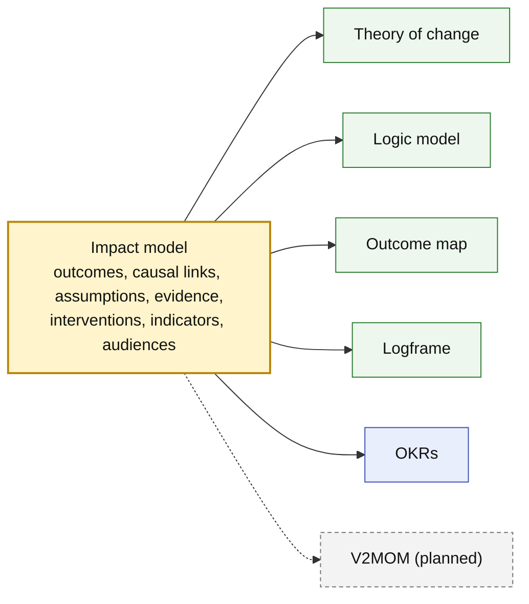
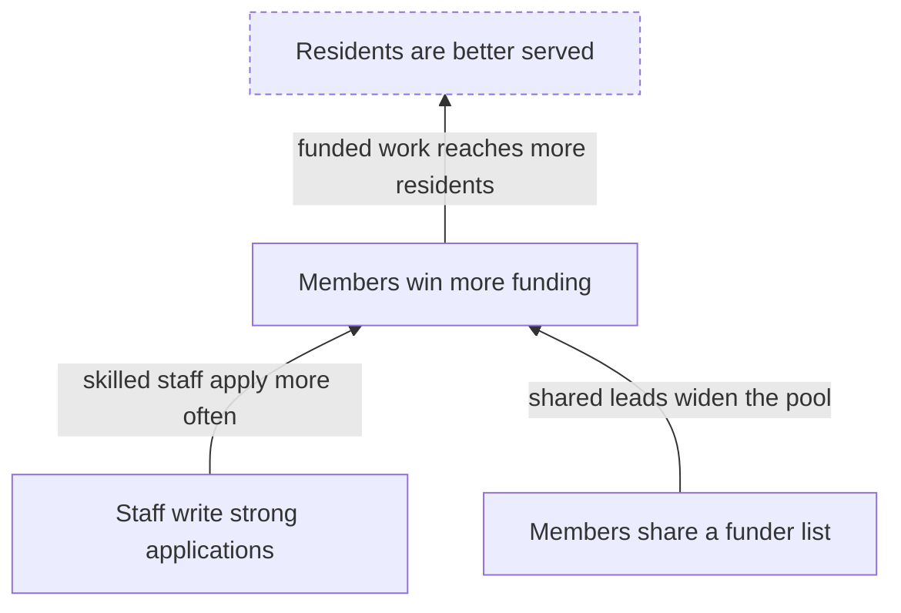
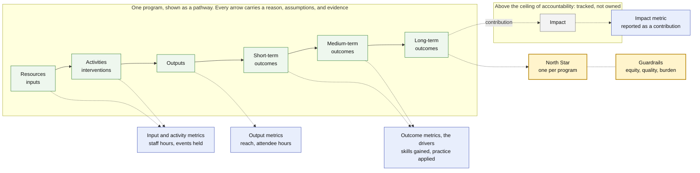
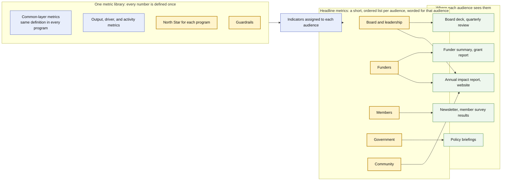

# Impact Model

[![Go CI][go-ci-svg]][go-ci-url]
[![Go Lint][go-lint-svg]][go-lint-url]
[![Go SAST][go-sast-svg]][go-sast-url]
[![Docs][docs-godoc-svg]][docs-godoc-url]
[![License][license-svg]][license-url]

 [go-ci-svg]: https://github.com/ProductBuildersHQ/impact-model/actions/workflows/go-ci.yaml/badge.svg?branch=main
 [go-ci-url]: https://github.com/ProductBuildersHQ/impact-model/actions/workflows/go-ci.yaml
 [go-lint-svg]: https://github.com/ProductBuildersHQ/impact-model/actions/workflows/go-lint.yaml/badge.svg?branch=main
 [go-lint-url]: https://github.com/ProductBuildersHQ/impact-model/actions/workflows/go-lint.yaml
 [go-sast-svg]: https://github.com/ProductBuildersHQ/impact-model/actions/workflows/go-sast-codeql.yaml/badge.svg?branch=main
 [go-sast-url]: https://github.com/ProductBuildersHQ/impact-model/actions/workflows/go-sast-codeql.yaml
 [docs-godoc-svg]: https://pkg.go.dev/badge/github.com/ProductBuildersHQ/impact-model
 [docs-godoc-url]: https://pkg.go.dev/github.com/ProductBuildersHQ/impact-model
 [license-svg]: https://img.shields.io/badge/license-MIT-blue.svg
 [license-url]: https://github.com/ProductBuildersHQ/impact-model/blob/main/LICENSE

**Impact Model** is an AI-native format from
[ProductBuildersHQ](https://github.com/ProductBuildersHQ) for describing how a
program, product, or organization expects to bring about change: what it does,
why that should work, and how it will know. It is a Go-first data model with
generated JSON Schema, plus an SDK, the `impact-model` CLI, and an MCP server.

You describe the change once, in one impact model. The
[theory of change](https://en.wikipedia.org/wiki/Theory_of_change), the logic
model, the outcome map, the logframe, and strategy formats such as OKRs and V2MOM
are **projections** of it. Each draws the same model for a different reader and
leaves something out, and none of them is a part of another.



## What is an impact model?

An impact model is one structured description of **how and why change is
expected to happen**. It holds:

- the **outcomes** that should change, at five levels from output to impact, and
  the **causal links** between them, each with a reason to believe it;
- the **assumptions** that must hold for a link to work, and the **evidence** for
  and against them;
- what is done to bring the change about: **interventions**, and the resources
  and outputs they need and produce;
- how progress is **measured**: indicators, targets, and observations over time;
- who is accountable for each change, and who needs to see what.

Every element records where it came from (stated, inferred, a hypothesis, or
confirmed), so a reader can tell what an organization has claimed from what an
assistant has proposed.

The model is a graph of causes and measures. A diagram or a table of it is a
projection, and one model can produce many.

## Projections

Each projection answers a different question for a different reader:

| Projection | Answers | Get it with |
|------------|---------|-------------|
| **Theory of change** | Why should what we do lead to the change we want, and in what order must outcomes happen? Drawn as pathways of change, from the earliest outcome at the bottom to the long-term goal at the top | `report pathway` |
| **Outcome map** | What changes, who is responsible for each change, and how is it measured? The outcomes by level, each with its sphere, owner, cause, and indicators | `report outcome-map` |
| **Logic model** | What goes in, what is done, and what comes out? Stages from inputs, activities, and outputs through short-, medium-, and long-term outcomes to impact, one per pathway | `report logic-model`, `logic-model-d2` |
| **Logframe** | What do we promise, and how will we verify it? Narrative, indicators with targets, means of verification, and assumptions, for contracts and monitoring | `report logframe` |
| **Metric tree and headline metrics** | What does each program steer by, and what is each audience told? | `report metric-tree`, `report headline` |
| **OKRs and outcome journeys** | What will a team commit to this quarter, and how does a person move through the outcomes? For the [PRISM](#part-of-the-prism-ecosystem) planning tools | `export okr`, `export journey` |
| **V2MOM** *(planned)* | What do we want, what matters, how will we get it, what is in the way, and how will we know? Vision, values, methods, obstacles, and measures, drawn from the model's vision, values, interventions, assumptions and risks, and indicators | — |

Each projection leaves something out. A logic model shows the sequence from what
goes in to what comes out, and rarely why each step holds. A theory of change
shows why, and says less about what is delivered. A logframe fits the model into
a matrix for contracts, and OKRs keep only what a team commits to for a period.
None is derived from another. The impact model holds what they all need, so any
of them can be drawn from it. A logic model that arrives on its own can seed a
*candidate* impact model, but it cannot supply the reasons and assumptions it
never held, so those stay marked as inferred until someone confirms them.

```bash
impact-model report pathway impact-model.yaml           # the theory of change, as pathways of change
impact-model report outcome-map impact-model.yaml       # the outcome map
impact-model report logic-model impact-model.yaml       # a logic model for each pathway
impact-model report logframe impact-model.yaml          # the logframe matrix
impact-model report definitions impact-model.yaml       # all of them, plus metrics and glossary
impact-model export okr impact-model.yaml               # OKRs for the PRISM tools
```

Change the model once and every projection changes with it, so the numbers and
labels never drift apart. (The outcome map here is the outcomes framework from the
ActKnowledge method; it is not IDRC's *Outcome Mapping*, which tracks progress
markers for the partners a program influences.)

## The theory of change

The theory of change is the projection most programs start from. It explains **how and why a program expects to bring about a
change**. It starts from the long-term goal and works backwards: what
conditions must exist for the goal to be reached, what must exist before each of
those, and so on down to what the program does today. Each step is an
**outcome**; each arrow between outcomes is a **causal link** with a reason for
believing it holds; and each belief that has to be true for a link to work is an
**assumption** that can be tested.



An illustration only. The dashed outcome sits above the organization's **ceiling
of accountability**: the program tracks it and contributes to it, but does not
claim it.

### Why it matters

The method is used by foundations, development agencies, and funders, and the
sources agree on five reasons:

- **Planning.** Agree on what has to change, and in what order, before spending
  money on activities.
- **Closing the "missing middle".** Show how day-to-day activities connect to a
  long-term goal, instead of asserting that they do.
- **Evaluability.** Indicators and tests come from the causal reasoning, so you
  know what to measure and what would count as being wrong.
- **Communication.** Funders, partners, staff, and the people the program serves
  can see the same reasoning and argue with it.
- **Learning.** The model is a living framework. When evidence arrives, you revise
  it instead of defending it.


## How the chain, the metrics, and what each audience sees fit together

An impact model is the chain from resources to impact. Metrics hang off each step
of it, and different readers should see a different few. The first diagram is one
program, shown as a pathway. The second shows how its metrics reach each audience.



Reading the first diagram:

- **Resource and activity metrics** show what went in and what was done.
  **Output metrics** show reach. **Outcome metrics** are the drivers: they
  say whether the change the program is for is happening.
- **A North Star** is the one number that best captures the value a program delivers
  to the people it serves. It sits on the highest outcome the program answers for, at
  or below the ceiling of accountability, and it is an outcome, never a count of
  outputs. Each program can have its own, because programs deliver different value.
  **Guardrails** keep it honest by watching what it could hurt, such as equity,
  quality, or staff burden.
- **Impact** sits above the ceiling. It is tracked and contributed to, not claimed.



Reading the second diagram:

- **Every number is defined once**, in one metric library. Two audiences that see the
  same figure see the same figure, with the same caveats and the same marker for
  whether it is attributable to the work or a contribution.
- **Headline metrics are what you tell people. The North Star is what you steer by.**
  They can differ. The board, funders, members, government, and the community each
  get a short list, worded for them, drawn from the same indicators. A North Star may
  lead one list and not appear in another.
- **Every box is something you can record and report today.** Mark an indicator as a
  program's North Star, with its guardrails, in the pathway's `focus`. Give each
  audience an ordered, worded `headline` list. `impact-model report metric-tree`
  shows a program's North Star and every indicator from activity to impact, and
  `impact-model report headline` shows what each audience is told. The amber boxes
  are the choices you make: which number a program steers by, and which few each
  audience leads with. `impact-model lint` checks them.

## What this project gives you

| Benefit | How |
|---------|-----|
| **A model you can trust** | Every element records whether a source *stated* it, you *inferred* it, it is still a *hypothesis*, or reviewers *confirmed* it. Reports show how much of the model is established and how much is our reading |
| **Edits that cannot make it worse** | One validated, atomic patch engine behind the CLI, the SDK, and the AI tools. A change that adds structural errors is rejected, and `--dry-run` shows the result first |
| **Quality you can check** | A schema, structural validation, 66 deterministic lint rules, and a rubric for human or AI judges, so "is this a good impact model?" has an answer you can repeat |
| **Progress you can measure** | Load a spreadsheet of numbers and see which indicators, outcomes, and pathways are on track, with assumptions that can cap a result and a confidence score for each route to impact |
| **Artifacts for each audience** | Executive and funder reports, audience stories, slide decks, Word and PowerPoint files, CSV tables, and OKR exports, all from one source and stamped with the version and hash |
| **Review that comes back** | Send a packet or sheet to reviewers, import their answers as proposed changes you inspect, then record approval |
| **Honest handling of people's data** | Stories and quotes appear only with consent, and restricted evidence is never rendered anywhere |
| **Ready for AI agents** | An MCP server with ten tools and five skills lets an agent draft, edit, measure, and report, under the same rules as a person |

It is meant for program and strategy teams, evaluators, funders, and anyone who has
to explain *why* what they do should lead to what they hope for, and then show
whether it did.

## Quick start

```bash
go install github.com/ProductBuildersHQ/impact-model/cmd/impact-model@latest

impact-model init --id my-program --name "My program" --out impact-model.yaml
impact-model validate impact-model.yaml
impact-model lint impact-model.yaml
impact-model report definitions impact-model.yaml --out definitions.md   # pathway, logic model, metrics, glossary
impact-model status impact-model.yaml -O observations.yaml                # how far it has come
impact-model mcp --root .                                          # serve the tools to an AI agent
```

Fictional, complete examples are in [`examples/`](examples/): a membership
network, a market-adoption model, and three competing futures that share
one actor registry.

## Documentation

The user guides are in [`docs/guides/`](docs/guides/index.md) and are published
as a documentation site (`mkdocs serve` runs it locally):

| To | Read |
|----|------|
| Install and try it | [Getting started](docs/guides/getting-started.md) |
| Write or change an impact model | [Authoring an impact model](docs/guides/authoring.md) |
| Measure progress | [Measuring progress](docs/guides/measurement.md) |
| Produce reports and decks | [Reports and decks](docs/guides/reports-and-decks.md) |
| Send an impact model out for review | [Review round trip](docs/guides/review-round-trip.md) |
| Check quality and run a judge | [Quality and judging](docs/guides/quality-and-judging.md) |
| Connect an AI agent | [MCP server and agent skills](docs/guides/mcp-and-skills.md) |
| Look up a command | [CLI reference](docs/guides/cli.md) |

Background: the [research brief](docs/research/theory-of-change.md), the
[concepts-to-types map](docs/concepts.md), and the specifications
([PRD](docs/specs/initiatives/INIT-THEORYOFCHANGESPEC-001/PRD.md),
[TRD](docs/specs/initiatives/INIT-THEORYOFCHANGESPEC-001/TRD.md),
[Plan](docs/specs/initiatives/INIT-THEORYOFCHANGESPEC-001/PLAN.md),
[Roadmap](docs/specs/initiatives/INIT-THEORYOFCHANGESPEC-001/ROADMAP.md)).

## Part of the PRISM ecosystem

Shared primitives come from
[prism-core](https://github.com/grokify/prism-core); OKR and outcome-journey
exports target [prism-roadmap](https://github.com/grokify/prism-roadmap);
rubrics and GO/NO-GO reports use
[structured-evaluation](https://github.com/plexusone/structured-evaluation).

## Credits

The impact model and its projections build on methods developed by many people:

- **ActKnowledge and the Center for Theory of Change:** preconditions, rationales
  for each link, and the accountability ceiling.
- **UNDG, *UNDAF Companion Guidance* (2017):** assumption types, and the problem
  tree of immediate, underlying, and structural causes.
- **Organizational Research Services for the Annie E. Casey Foundation:** outcomes
  along time horizons.
- **Aspen Institute Roundtable on Community Change:** the plausible, feasible, and
  testable criteria.
- **Outcome Mapping (IDRC):** spheres of control, influence, and interest, and
  boundary partners.
- **Contribution analysis (Mayne) and process tracing (Van Evera; Befani and
  Mayne):** attribution versus contribution, and graded evidence.
- **Most Significant Change (Davies and Dart) and Outcome Harvesting (Wilson-Grau
  and Britt):** stories coded into themes, and harvested outcomes.
- **The Kellogg Foundation and logical framework traditions:** logic models and
  logframes.

It builds on the [PRISM](#part-of-the-prism-ecosystem) projects and
[oscompat](https://github.com/grokify/oscompat), on [Cobra](https://github.com/spf13/cobra),
[yaml.v3](https://github.com/go-yaml/yaml), the
[MCP Go SDK](https://github.com/modelcontextprotocol/go-sdk), and the other modules
listed in [THIRD_PARTY_NOTICES.md](THIRD_PARTY_NOTICES.md), and it can call
[Marp](https://marp.app), the [Mermaid CLI](https://github.com/mermaid-js/mermaid-cli),
and [Pandoc](https://pandoc.org) when they are installed. [Credits](docs/credits.md)
maps each source to the part of the spec that uses it and lists the works cited.
Naming a source does not mean its authors endorse this project.

Every dependency in the binary is under a permissive license (MIT, BSD-3-Clause, or
Apache-2.0). Their license and notice files are in
[`third_party/licenses/`](third_party/licenses/), regenerated with
`scripts/third-party-notices.sh`.

## License

[MIT](LICENSE)
