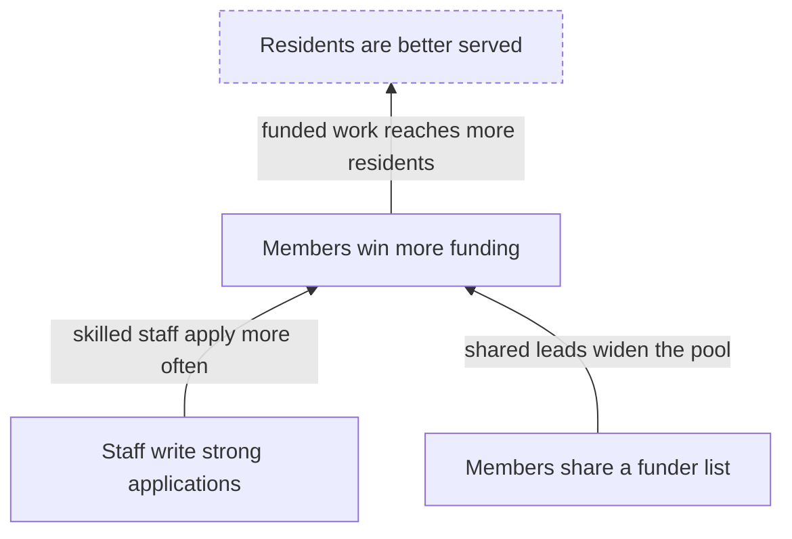

# Theory of Change Spec

An AI-native, spec-driven way to capture, measure, and report on a
[Theory of Change](https://en.wikipedia.org/wiki/Theory_of_change): a Go-first
data model with generated JSON Schema, plus an SDK, the `theoryofchange` CLI,
and an MCP server.

## What is a Theory of Change?

A Theory of Change explains **how and why a program expects to bring about a
change**. It starts from the long-term goal and works backwards: what
conditions must exist for the goal to be reached, what must exist before each of
those, and so on down to what the program does today. Each step is an
**outcome**; each arrow between outcomes is a **causal link** with a reason for
believing it holds; and each belief that has to be true for a link to work is an
**assumption** that can be tested.



An illustration only. The dashed outcome sits above the organization's **ceiling
of accountability**: the program tracks it and contributes to it, but does not
claim it.

### Why it matters

The method is used by foundations, development agencies, and funders, and the
sources agree on five reasons:

- **Planning.** Agree on what has to change, and in what order, before spending
  money on activities.
- **Closing the "missing middle".** Show how day-to-day activities connect to a
  long-term goal, instead of asserting that they do.
- **Evaluability.** Indicators and tests come from the theory, so you know what to
  measure and what would count as being wrong.
- **Communication.** Funders, partners, staff, and the people the program serves
  can see the same reasoning and argue with it.
- **Learning.** The theory is a living framework. When evidence arrives, you revise
  the theory instead of defending it.

### Pathways of change, outcome maps, and logic models

These are different **views of one theory**. Each answers a different question for
a different reader:

| View | Answers | What it looks like |
|------|---------|--------------------|
| **Pathway of change** | In what order must outcomes happen to reach the goal? | The chains of outcomes, from the earliest at the bottom to the long-term goal at the top. A program usually has several; together they are the *outcomes framework* |
| **Outcome map** | What changes, who is responsible for each change, and how is it measured? | The outcomes grouped by level, each with its sphere, whether the organization owns it or only monitors it, who delivers it, the cause it addresses, and the indicators that measure it |
| **Logic model** | What goes in, what is done, and what comes out? | Stages from inputs, activities, and outputs through short-term, intermediate, and long-term outcomes to impact, one model per pathway |
| **Logframe** | What do we promise, and how will we verify it? | A matrix of narrative, indicators with targets, means of verification, and assumptions, for contracts and monitoring |

A logic model or logframe is a *flattened* picture: it shows the sequence but
rarely why each step holds, and it cannot hold several pathways, feedback loops, or
the actors who are not you. You can generate a logic model from a Theory of
Change; you cannot recover the theory from a logic model. So this project keeps the
**theory as the source of truth** and produces every other view from it:

```bash
theoryofchange report pathway theory.yaml           # the pathways of change, as diagrams
theoryofchange report outcome-map theory.yaml       # the outcome map
theoryofchange report logic-model theory.yaml       # a logic model for each pathway
theoryofchange report logframe theory.yaml          # the logframe matrix
theoryofchange report definitions theory.yaml       # all of them, plus metrics and glossary
```

Change the theory once and every view changes with it, so the numbers and labels
never drift apart. (The outcome map here is the outcomes framework from the
ActKnowledge method; it is not IDRC's *Outcome Mapping*, which tracks progress
markers for the partners a program influences.)

## What this project gives you

| Benefit | How |
|---------|-----|
| **A theory you can trust** | Every element records whether a source *stated* it, you *inferred* it, it is still a *hypothesis*, or reviewers *confirmed* it. Reports show how much of the theory is established and how much is our reading |
| **Edits that cannot make it worse** | One validated, atomic patch engine behind the CLI, the SDK, and the AI tools. A change that adds structural errors is rejected, and `--dry-run` shows the result first |
| **Quality you can check** | A schema, structural validation, 48 deterministic lint rules, and a rubric for human or AI judges, so "is this a good theory?" has an answer you can repeat |
| **Progress you can measure** | Load a spreadsheet of numbers and see which indicators, outcomes, and pathways are on track, with assumptions that can cap a result and a confidence score for each route to impact |
| **Artifacts for each audience** | Executive and funder reports, audience stories, slide decks, Word and PowerPoint files, CSV tables, and OKR exports, all from one source and stamped with the version and hash |
| **Review that comes back** | Send a packet or sheet to reviewers, import their answers as proposed changes you inspect, then record approval |
| **Honest handling of people's data** | Stories and quotes appear only with consent, and restricted evidence is never rendered anywhere |
| **Ready for AI agents** | An MCP server with ten tools and five skills lets an agent draft, edit, measure, and report, under the same rules as a person |

It is meant for program and strategy teams, evaluators, funders, and anyone who has
to explain *why* what they do should lead to what they hope for, and then show
whether it did.

## Start here

| If you want to | Read |
|----------------|------|
| Install it and try it in five minutes | [Getting started](guides/getting-started.md) |
| Write or change a theory | [Authoring a theory](guides/authoring.md) |
| See how far a program has come | [Measuring progress](guides/measurement.md) |
| Produce reports and decks | [Reports and decks](guides/reports-and-decks.md) |
| Send a theory out for review | [Review round trip](guides/review-round-trip.md) |
| Judge the quality of a theory | [Quality and judging](guides/quality-and-judging.md) |
| Connect an AI agent | [MCP server and agent skills](guides/mcp-and-skills.md) |
| Look at a complete theory | [Examples](guides/examples.md) |

The [release notes](releases/v0.1.0.md) list what the first release contains.

## Part of the PRISM ecosystem

Shared primitives come from [prism-core](https://github.com/grokify/prism-core);
OKR and outcome-journey exports target
[prism-roadmap](https://github.com/grokify/prism-roadmap); rubrics and GO/NO-GO
reports use [structured-evaluation](https://github.com/plexusone/structured-evaluation).

## License

[MIT](https://github.com/ProductBuildersHQ/theoryofchange-spec/blob/main/LICENSE)
