## Layered logic model: Learning Exchange

```mermaid
flowchart LR
  classDef activities fill:#e4f3e5,stroke:#2e7d32
  classDef impact fill:#c5cfe8,stroke:#1f3a7a
  classDef inputs fill:#fff1dc,stroke:#e08a1e
  classDef long_term fill:#d3dcee,stroke:#2c4a8a
  classDef medium_term fill:#dfe8f6,stroke:#3f5fa8
  classDef outputs fill:#ece4fb,stroke:#7e57c2
  classDef short_term fill:#e1f3fd,stroke:#2d9cdb
  classDef stage fill:transparent,stroke-width:0px
  subgraph n_inputs["Inputs"]
    n_inputs__input1["Two program staff and meeting space donated by the county library system"]
    n_inputs__input2["One program staff member and a pool of volunteer coaches"]
    n_inputs__input3["Fee-for-service agreement with the training partner"]
  end
  subgraph n_activities["Activities"]
    n_activities_int_peer_cohorts["Run mixed-size peer-learning cohorts"]
    n_activities_int_leader_coaching["Offer one-to-one leadership coaching"]
    n_activities_int_training_series["Deliver a management skills training series (inferred)"]
  end
  subgraph n_outputs["Outputs"]
    n_outputs__output1["Cohort sessions held"]
    n_outputs__output2["Peer-pairing introductions"]
    n_outputs_oc_out_cohorts["Peer-learning cohorts and coaching sessions delivered"]
    n_outputs__output3["Coaching hours delivered"]
    n_outputs__output4["Workshops delivered"]
    n_outputs__output5["Participant materials"]
  end
  subgraph n_short_term["Short-term outcomes"]
    n_short_term_oc_st_peer_ties["Members form peer relationships across sizes (inferred)"]
    n_short_term_oc_st_leader_skills["Leaders gain coaching-based skills and confidence"]
  end
  subgraph n_medium_term["Medium-term outcomes"]
    n_medium_term_oc_im_peer_network["Members turn to each other for advice and joint work (inferred)"]
    n_medium_term_oc_im_joint_positions["Members adopt and share joint positions on local issues (hypothesis)"]
    n_medium_term_oc_im_leaders_practice["Member leaders apply improved management practices"]
  end
  subgraph n_long_term["Long-term outcomes"]
    n_long_term_oc_lt_collab["Members routinely collaborate instead of duplicating effort"]
    n_long_term_oc_lt_collective_voice["Local government and funders consult members through a coordinated channel (hypothesis)"]
    n_long_term_oc_lt_capable_members["Member nonprofits run strong, well-managed organizations"]
  end
  subgraph n_impact["Impact"]
    n_impact_oc_resident_voice["Residents' priorities shape local public decisions (hypothesis)"]
    n_impact_oc_resident_access["Residents get timely, good-quality services from local nonprofits (inferred)"]
  end
  n_inputs__input1 --> n_activities_int_peer_cohorts
  n_activities_int_peer_cohorts --> n_outputs__output1
  n_activities_int_peer_cohorts --> n_outputs__output2
  n_activities_int_peer_cohorts --> n_outputs_oc_out_cohorts
  n_outputs__output1 --> n_short_term_oc_st_peer_ties
  n_outputs__output2 --> n_short_term_oc_st_peer_ties
  n_inputs__input2 --> n_activities_int_leader_coaching
  n_activities_int_leader_coaching --> n_outputs__output3
  n_activities_int_leader_coaching --> n_outputs_oc_out_cohorts
  n_outputs__output3 --> n_short_term_oc_st_leader_skills
  n_inputs__input3 --> n_activities_int_training_series
  n_activities_int_training_series --> n_outputs__output4
  n_activities_int_training_series --> n_outputs__output5
  n_outputs__output4 --> n_short_term_oc_st_leader_skills
  n_outputs__output5 --> n_short_term_oc_st_leader_skills
  n_outputs_oc_out_cohorts --> n_short_term_oc_st_leader_skills
  n_outputs_oc_out_cohorts --> n_short_term_oc_st_peer_ties
  n_short_term_oc_st_leader_skills --> n_medium_term_oc_im_leaders_practice
  n_short_term_oc_st_peer_ties --> n_medium_term_oc_im_peer_network
  n_medium_term_oc_im_leaders_practice --> n_long_term_oc_lt_capable_members
  n_medium_term_oc_im_peer_network --> n_long_term_oc_lt_collab
  n_short_term_oc_st_peer_ties --> n_medium_term_oc_im_joint_positions
  n_medium_term_oc_im_joint_positions --> n_long_term_oc_lt_collab
  n_medium_term_oc_im_joint_positions --> n_long_term_oc_lt_collective_voice
  n_long_term_oc_lt_capable_members --> n_impact_oc_resident_access
  n_long_term_oc_lt_collab --> n_impact_oc_resident_access
  n_long_term_oc_lt_collective_voice --> n_impact_oc_resident_voice
  n_long_term_oc_lt_collab --> n_impact_oc_resident_voice
  class n_inputs__input1 inputs
  class n_inputs__input2 inputs
  class n_inputs__input3 inputs
  class n_inputs stage
  class n_activities_int_peer_cohorts activities
  class n_activities_int_leader_coaching activities
  class n_activities_int_training_series activities
  class n_activities stage
  class n_outputs__output1 outputs
  class n_outputs__output2 outputs
  class n_outputs_oc_out_cohorts outputs
  class n_outputs__output3 outputs
  class n_outputs__output4 outputs
  class n_outputs__output5 outputs
  class n_outputs stage
  class n_short_term_oc_st_peer_ties short_term
  class n_short_term_oc_st_leader_skills short_term
  class n_short_term stage
  class n_medium_term_oc_im_peer_network medium_term
  class n_medium_term_oc_im_joint_positions medium_term
  class n_medium_term_oc_im_leaders_practice medium_term
  class n_medium_term stage
  class n_long_term_oc_lt_collab long_term
  class n_long_term_oc_lt_collective_voice long_term
  class n_long_term_oc_lt_capable_members long_term
  class n_long_term stage
  class n_impact_oc_resident_voice impact
  class n_impact_oc_resident_access impact
  class n_impact stage
```

Feedback, not drawn:

- Members routinely collaborate instead of duplicating effort leads back to Members form peer relationships across sizes (inferred)

## Layered logic model: Shared Services

```mermaid
flowchart LR
  classDef activities fill:#e4f3e5,stroke:#2e7d32
  classDef impact fill:#c5cfe8,stroke:#1f3a7a
  classDef inputs fill:#fff1dc,stroke:#e08a1e
  classDef long_term fill:#d3dcee,stroke:#2c4a8a
  classDef medium_term fill:#dfe8f6,stroke:#3f5fa8
  classDef outputs fill:#ece4fb,stroke:#7e57c2
  classDef short_term fill:#e1f3fd,stroke:#2d9cdb
  classDef stage fill:transparent,stroke-width:0px
  subgraph n_inputs["Inputs"]
    n_inputs__input1["One shared-services coordinator and contracted bookkeepers"]
    n_inputs__input2["Part of one staff role"]
  end
  subgraph n_activities["Activities"]
    n_activities_int_pooled_backoffice["Run pooled bookkeeping and payroll help"]
    n_activities_int_group_purchasing["Negotiate group purchasing agreements"]
    n_activities_int_grants_calendar["Maintain a shared grants calendar"]
  end
  subgraph n_outputs["Outputs"]
    n_outputs__output1["Member accounts onboarded"]
    n_outputs__output2["Shared service desk"]
    n_outputs_oc_out_services["Pooled service contracts and group purchasing deals in place"]
    n_outputs__output3["Vendor agreements signed"]
    n_outputs_oc_out_calendar["Shared grants calendar published and kept current (inferred)"]
    n_outputs__output4["Monthly calendar update"]
    n_outputs__output5["Deadline reminders"]
  end
  subgraph n_short_term["Short-term outcomes"]
    n_short_term_oc_st_pooled_use["Members use pooled back-office services (inferred)"]
    n_short_term_oc_st_calendar_use["Members consult the shared grants calendar when planning (hypothesis)"]
  end
  subgraph n_medium_term["Medium-term outcomes"]
    n_medium_term_oc_im_lower_overhead["Members spend less staff time and money on back-office work"]
    n_medium_term_oc_im_grant_pipeline["Members apply for more grants that fit their mission (inferred)"]
  end
  subgraph n_long_term["Long-term outcomes"]
    n_long_term_oc_lt_capable_members["Member nonprofits run strong, well-managed organizations"]
    n_long_term_oc_lt_collab["Members routinely collaborate instead of duplicating effort"]
    n_long_term_oc_lt_sustainable["Members have diversified, stable funding (inferred)"]
  end
  subgraph n_impact["Impact"]
    n_impact_oc_resident_access["Residents get timely, good-quality services from local nonprofits (inferred)"]
    n_impact_oc_resident_voice["Residents' priorities shape local public decisions (hypothesis)"]
  end
  n_inputs__input1 --> n_activities_int_pooled_backoffice
  n_activities_int_pooled_backoffice --> n_outputs__output1
  n_activities_int_pooled_backoffice --> n_outputs__output2
  n_activities_int_pooled_backoffice --> n_outputs_oc_out_services
  n_outputs__output1 --> n_short_term_oc_st_pooled_use
  n_outputs__output2 --> n_short_term_oc_st_pooled_use
  n_activities_int_group_purchasing --> n_outputs__output3
  n_activities_int_group_purchasing --> n_outputs_oc_out_services
  n_inputs__input2 --> n_activities_int_grants_calendar
  n_activities_int_grants_calendar --> n_outputs__output4
  n_activities_int_grants_calendar --> n_outputs__output5
  n_activities_int_grants_calendar --> n_outputs_oc_out_calendar
  n_outputs__output4 --> n_short_term_oc_st_calendar_use
  n_outputs__output5 --> n_short_term_oc_st_calendar_use
  n_outputs_oc_out_services --> n_short_term_oc_st_pooled_use
  n_outputs_oc_out_calendar --> n_short_term_oc_st_calendar_use
  n_short_term_oc_st_pooled_use --> n_medium_term_oc_im_lower_overhead
  n_short_term_oc_st_calendar_use --> n_medium_term_oc_im_grant_pipeline
  n_medium_term_oc_im_lower_overhead --> n_long_term_oc_lt_capable_members
  n_medium_term_oc_im_lower_overhead --> n_long_term_oc_lt_collab
  n_medium_term_oc_im_lower_overhead --> n_long_term_oc_lt_sustainable
  n_medium_term_oc_im_grant_pipeline --> n_long_term_oc_lt_sustainable
  n_long_term_oc_lt_capable_members --> n_impact_oc_resident_access
  n_long_term_oc_lt_collab --> n_impact_oc_resident_access
  n_long_term_oc_lt_sustainable --> n_impact_oc_resident_access
  n_long_term_oc_lt_collab --> n_impact_oc_resident_voice
  class n_inputs__input1 inputs
  class n_inputs__input2 inputs
  class n_inputs stage
  class n_activities_int_pooled_backoffice activities
  class n_activities_int_group_purchasing activities
  class n_activities_int_grants_calendar activities
  class n_activities stage
  class n_outputs__output1 outputs
  class n_outputs__output2 outputs
  class n_outputs_oc_out_services outputs
  class n_outputs__output3 outputs
  class n_outputs_oc_out_calendar outputs
  class n_outputs__output4 outputs
  class n_outputs__output5 outputs
  class n_outputs stage
  class n_short_term_oc_st_pooled_use short_term
  class n_short_term_oc_st_calendar_use short_term
  class n_short_term stage
  class n_medium_term_oc_im_lower_overhead medium_term
  class n_medium_term_oc_im_grant_pipeline medium_term
  class n_medium_term stage
  class n_long_term_oc_lt_capable_members long_term
  class n_long_term_oc_lt_collab long_term
  class n_long_term_oc_lt_sustainable long_term
  class n_long_term stage
  class n_impact_oc_resident_access impact
  class n_impact_oc_resident_voice impact
  class n_impact stage
```

## Layered logic model: Civic Voice

```mermaid
flowchart LR
  classDef activities fill:#e4f3e5,stroke:#2e7d32
  classDef impact fill:#c5cfe8,stroke:#1f3a7a
  classDef long_term fill:#d3dcee,stroke:#2c4a8a
  classDef medium_term fill:#dfe8f6,stroke:#3f5fa8
  classDef outputs fill:#ece4fb,stroke:#7e57c2
  classDef short_term fill:#e1f3fd,stroke:#2d9cdb
  classDef stage fill:transparent,stroke-width:0px
  subgraph n_activities["Activities"]
    n_activities_int_policy_briefings["Publish plain-language policy briefings (hypothesis)"]
    n_activities_int_joint_forums["Convene member forums to draft joint positions"]
    n_activities_int_liaison_channel["Set up a standing liaison channel with the county planning office"]
    n_activities_int_funder_roundtable["Host a funder and member roundtable"]
  end
  subgraph n_outputs["Outputs"]
    n_outputs_oc_out_briefings["Policy briefings and joint-position drafts produced (hypothesis)"]
    n_outputs__output1["Briefings published"]
    n_outputs__output2["Forums held"]
    n_outputs__output3["Joint position drafts"]
    n_outputs__output4["Quarterly liaison meeting"]
    n_outputs__output5["Named contacts on both sides"]
    n_outputs__output6["Roundtable held twice a year"]
  end
  subgraph n_short_term["Short-term outcomes"]
    n_short_term_oc_st_policy_know["Members understand local policy and funding processes (inferred)"]
    n_short_term_oc_st_channel["A standing channel exists between members and the county planning office"]
  end
  subgraph n_medium_term["Medium-term outcomes"]
    n_medium_term_oc_im_joint_positions["Members adopt and share joint positions on local issues (hypothesis)"]
    n_medium_term_oc_im_officials_engage["Local officials and funders engage members in planning"]
  end
  subgraph n_long_term["Long-term outcomes"]
    n_long_term_oc_lt_collab["Members routinely collaborate instead of duplicating effort"]
    n_long_term_oc_lt_collective_voice["Local government and funders consult members through a coordinated channel (hypothesis)"]
  end
  subgraph n_impact["Impact"]
    n_impact_oc_resident_access["Residents get timely, good-quality services from local nonprofits (inferred)"]
    n_impact_oc_resident_voice["Residents' priorities shape local public decisions (hypothesis)"]
  end
  n_activities_int_policy_briefings --> n_outputs__output1
  n_activities_int_policy_briefings --> n_outputs_oc_out_briefings
  n_outputs__output1 --> n_short_term_oc_st_policy_know
  n_activities_int_joint_forums --> n_outputs__output2
  n_activities_int_joint_forums --> n_outputs__output3
  n_outputs__output2 --> n_short_term_oc_st_policy_know
  n_outputs__output3 --> n_short_term_oc_st_policy_know
  n_outputs__output2 --> n_medium_term_oc_im_joint_positions
  n_outputs__output3 --> n_medium_term_oc_im_joint_positions
  n_activities_int_liaison_channel --> n_outputs__output4
  n_activities_int_liaison_channel --> n_outputs__output5
  n_outputs__output4 --> n_short_term_oc_st_channel
  n_outputs__output5 --> n_short_term_oc_st_channel
  n_activities_int_funder_roundtable --> n_outputs__output6
  n_outputs__output6 --> n_short_term_oc_st_channel
  n_outputs__output6 --> n_medium_term_oc_im_officials_engage
  n_outputs_oc_out_briefings --> n_short_term_oc_st_policy_know
  n_short_term_oc_st_policy_know --> n_medium_term_oc_im_joint_positions
  n_medium_term_oc_im_joint_positions --> n_long_term_oc_lt_collab
  n_medium_term_oc_im_joint_positions --> n_long_term_oc_lt_collective_voice
  n_medium_term_oc_im_officials_engage --> n_long_term_oc_lt_collective_voice
  n_short_term_oc_st_channel --> n_medium_term_oc_im_officials_engage
  n_long_term_oc_lt_collab --> n_impact_oc_resident_access
  n_long_term_oc_lt_collective_voice --> n_impact_oc_resident_voice
  n_long_term_oc_lt_collab --> n_impact_oc_resident_voice
  class n_activities_int_policy_briefings activities
  class n_activities_int_joint_forums activities
  class n_activities_int_liaison_channel activities
  class n_activities_int_funder_roundtable activities
  class n_activities stage
  class n_outputs_oc_out_briefings outputs
  class n_outputs__output1 outputs
  class n_outputs__output2 outputs
  class n_outputs__output3 outputs
  class n_outputs__output4 outputs
  class n_outputs__output5 outputs
  class n_outputs__output6 outputs
  class n_outputs stage
  class n_short_term_oc_st_policy_know short_term
  class n_short_term_oc_st_channel short_term
  class n_short_term stage
  class n_medium_term_oc_im_joint_positions medium_term
  class n_medium_term_oc_im_officials_engage medium_term
  class n_medium_term stage
  class n_long_term_oc_lt_collab long_term
  class n_long_term_oc_lt_collective_voice long_term
  class n_long_term stage
  class n_impact_oc_resident_access impact
  class n_impact_oc_resident_voice impact
  class n_impact stage
```

