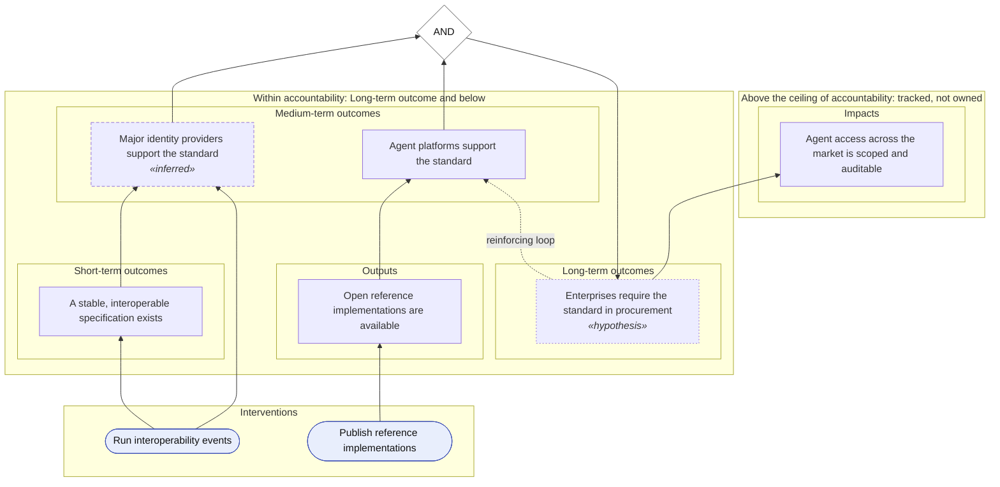

# Open agent authorization standard adoption: definitions

## Problem tree

Causes (roots) below lead up to the core problem, which leads up to its effects (branches).

```mermaid
flowchart BT
  classDef cause fill:#f3e6d8,stroke:#8d5a2b
  classDef effect fill:#e4f3e5,stroke:#2e7d32
  classDef problem fill:#ffe0b2,stroke:#e08a1e
  classDef row fill:transparent,stroke-width:0px
  classDef set_aside fill:#f3f3f3,stroke:#9e9e9e
  classDef zone fill:transparent,stroke-width:0px
  subgraph n_effects["Effects (branches)"]
    subgraph n_effects_r2[""]
      n_effects_r2_eff_slow_adoption["Agent platforms adopt delegated access slowly. (set aside)"]
    end
    subgraph n_effects_r1[""]
      n_effects_r1_eff_custom_integrations["Every enterprise pays for custom identity integrations."]
    end
  end
  subgraph n_core["Core problem"]
    subgraph n_core_r0[""]
      n_core_r0_problem["AI agents act on behalf of users with credentials designed for humans, so access is over-broad and unauditable."]
    end
  end
  subgraph n_causes["Causes (roots)"]
    subgraph n_causes_r_1[""]
      n_causes_r_1_cause_fragmented_auth["Agents authenticate in incompatible ways. (set aside)"]
      n_causes_r_1_cause_no_reference["There is no reference implementation to copy."]
    end
    subgraph n_causes_r_2[""]
      n_causes_r_2_cause_no_demand_signal["Providers see no customer demand for a common standard."]
    end
  end
  n_causes_r_1_cause_fragmented_auth --> n_core_r0_problem
  n_causes_r_2_cause_no_demand_signal --> n_causes_r_1_cause_no_reference
  n_causes_r_1_cause_no_reference --> n_core_r0_problem
  n_core_r0_problem --> n_effects_r1_eff_custom_integrations
  n_effects_r1_eff_custom_integrations --> n_effects_r2_eff_slow_adoption
  class n_effects_r2_eff_slow_adoption set_aside
  class n_effects_r2 row
  class n_effects_r1_eff_custom_integrations effect
  class n_effects_r1 row
  class n_effects zone
  class n_core_r0_problem problem
  class n_core_r0 row
  class n_core zone
  class n_causes_r_1_cause_fragmented_auth set_aside
  class n_causes_r_1_cause_no_reference cause
  class n_causes_r_1 row
  class n_causes_r_2_cause_no_demand_signal cause
  class n_causes_r_2 row
  class n_causes zone
```

### Causes

| Cause | Level | Leads to | Addressed by |
|-------|-------|----------|--------------|
| Agents authenticate in incompatible ways. (`cause-fragmented-auth`) | structural | the core problem | set aside: Needs regulation beyond this initiative. |
| Providers see no customer demand for a common standard. (`cause-no-demand-signal`) | underlying | There is no reference implementation to copy. (`cause-no-reference`) | Major identity providers support the standard (`oc-idp-support`) |
| There is no reference implementation to copy. (`cause-no-reference`) | immediate | the core problem | — |

### Effects

| Effect | Follows from | Relieved by |
|--------|--------------|-------------|
| Every enterprise pays for custom identity integrations. (`eff-custom-integrations`) | the core problem | Major identity providers support the standard (`oc-idp-support`) |
| Agent platforms adopt delegated access slowly. (`eff-slow-adoption`) | Every enterprise pays for custom identity integrations. (`eff-custom-integrations`) | set aside: Platform roadmaps are outside this initiative. |

## Causal pathways

### The theory of change on one page


### Supply side: providers and platforms



## Logic model: Supply side: providers and platforms

Getting identity providers and agent platforms to ship the standard.

| Stage | Elements |
|-------|----------|
| Inputs | Two engineers and an event budget |
| Activities | Run interoperability events; Publish reference implementations |
| Outputs | Interop test suite; Event reports; Open reference implementations are available |
| Short-term outcomes | A stable, interoperable specification exists |
| Medium-term outcomes | Major identity providers support the standard _(inferred)_; Agent platforms support the standard |
| Long-term outcomes | Enterprises require the standard in procurement _(hypothesis)_ |
| Impact | Agent access across the market is scoped and auditable |

## Outcome map: Supply side: providers and platforms

_This is a view of the causal model. It flattens the links between outcomes; the pathway diagram shows them._

### Impact

| Outcome | Sphere | Category | Change | Responsibility | Delivered by | Addresses | Measured by |
|---------|--------|----------|--------|----------------|--------------|-----------|-------------|
| Agent access across the market is scoped and auditable (`oc-safer-agents`) | Interest | respond | — | Own · above the ceiling, monitored only | — | — | ind-adoption-stories |

### Long-term outcome

| Outcome | Sphere | Category | Change | Responsibility | Delivered by | Addresses | Measured by |
|---------|--------|----------|--------|----------------|--------------|-----------|-------------|
| Enterprises require the standard in procurement (`oc-enterprise-require`) _(hypothesis)_ | Influence | expand | Policy | Own | — | — | — |

### Medium-term outcome

| Outcome | Sphere | Category | Change | Responsibility | Delivered by | Addresses | Measured by |
|---------|--------|----------|--------|----------------|--------------|-----------|-------------|
| Major identity providers support the standard (`oc-idp-support`) _(inferred)_ | Influence | adopt | Adoption | Shared | Standards working group, Identity providers | cause-no-demand-signal | ind-idp-count, ind-idp-count-na, ind-idp-count-eu, ind-idp-total |
| Agent platforms support the standard (`oc-platform-support`) | Influence | adapt | Adoption | Partner · monitored only | Identity providers | — | — |

### Short-term outcome

| Outcome | Sphere | Category | Change | Responsibility | Delivered by | Addresses | Measured by |
|---------|--------|----------|--------|----------------|--------------|-----------|-------------|
| A stable, interoperable specification exists (`oc-spec-stable`) | Control | — | Condition | Own | — | — | — |

### Output

| Outcome | Sphere | Category | Change | Responsibility | Delivered by | Addresses | Measured by |
|---------|--------|----------|--------|----------------|--------------|-----------|-------------|
| Open reference implementations are available (`oc-reference-impl`) | Control | — | — | Own | — | — | — |

## Logframe: Supply side: providers and platforms

_This is a view of the causal model. It flattens the links between outcomes; the pathway diagram shows them._

| Level | Narrative | Indicators and targets | Means of verification | Assumptions |
|-------|-----------|------------------------|-----------------------|-------------|
| Goal | Agent access across the market is scoped and auditable (`oc-safer-agents`) | Stories of provider adoption (`ind-adoption-stories`) | not stated | — |
| Purpose | Enterprises require the standard in procurement (`oc-enterprise-require`) _(hypothesis)_ | — | — | — |
| Purpose | Major identity providers support the standard (`oc-idp-support`) _(inferred)_ | Identity providers with generally available support (`ind-idp-count`): 2 providers (by 2026-12-31) — First movers; 5 providers (by 2027-12-31) (Covers half the market by seats); Providers with GA support (North America) (`ind-idp-count-na`); Providers with GA support (Europe) (`ind-idp-count-eu`); Providers with GA support (total) (`ind-idp-total`) | Provider release notes; Desk review; P3M; not stated; not stated; not stated | Identity providers see commercial advantage in supporting agent delegation. (`asm-idp-incentive`) |
| Purpose | Agent platforms support the standard (`oc-platform-support`) | — | — | — |
| Outputs | A stable, interoperable specification exists (`oc-spec-stable`) | — | — | — |
| Outputs | Open reference implementations are available (`oc-reference-impl`) | — | — | — |
| Activities | Run interoperability events (`int-interop`) | — | — | — |
| Activities | Publish reference implementations (`int-reference`) | Reference implementation downloads (`ind-reference-downloads`) | not stated | — |

## Metric definitions

| Metric | Definition | Formula | Unit | Direction | Combines across pathways | Layer | Used by |
|--------|------------|---------|------|-----------|--------------------------|-------|---------|
| Providers with GA support | Identity providers shipping the standard in a general-availability release. | Count of distinct providers with a GA release implementing the standard. | providers | Increase | Sum | Common | Identity providers with generally available support; Providers with GA support (North America); Providers with GA support (Europe); Providers with GA support (total) |
| Share of provider seats covered | Share of provider seats that can use the standard. | Seats at providers with GA support divided by seats at all tracked providers, weighted by seats. | percent | Increase | Mean weighted by Providers with GA support | Pathway | — |

## Glossary

| Term | Definition | Examples |
|------|------------|----------|
| General availability | A release available to all customers without special arrangement, as opposed to a preview. | A vendor's public release notes list the feature without a preview label. |

