```mermaid
flowchart LR
  subgraph tier_activity["activity"]
    i_ind_hours_civic["Attendee hours: Civic Voice"]
  end
  subgraph tier_output["output"]
    i_ind_briefings["Policy briefings and joint-position drafts published"]
  end
  tier_activity --> tier_output
  subgraph tier_outcome["outcome"]
    i_ind_hours_total["Attendee hours across all three program areas"]
    i_ind_reach_civic["Member organizations reached: Civic Voice"]
    i_ind_reach_network["Member organizations reached across the whole network"]
    i_ind_joint_positions["Joint positions adopted by members"]
    i_ind_officials_meetings["Public planning processes that invited members"]
  end
  tier_output --> tier_outcome
  subgraph tier_impact["impact"]
    i_ind_residents_served["Residents served by member organizations"]
  end
  tier_outcome --> tier_impact
  classDef northstar fill:#fde68a,stroke:#b45309,stroke-width:2px
  classDef guardrail fill:#e5e7eb,stroke:#6b7280,stroke-dasharray:4 3
```

# Riverbend Nonprofit Network theory of change: metric tree

As of 2026-09-30.

## Learning Exchange

No North Star is chosen for this pathway.

| Tier | Indicator | Latest | Target | Status |
|------|-----------|--------|--------|--------|
| activity | Attendee hours: Learning Exchange | 3650 hours (on 2026-09-30) | 4000 hours (by 2026-12-31); 4800 hours (by 2027-12-31); 5400 hours (by 2028-12-31) | On track |
| output | Member organizations reached: Learning Exchange | 55 member organizations (on 2026-09-30) | 60 member organizations (by 2026-12-31); 72 member organizations (by 2027-12-31); 80 member organizations (by 2028-12-31) | On track |
| output | Enrollments: Learning Exchange | — | 150 participants (by 2026-12-31); 170 participants (by 2027-12-31) | Not started |
| outcome | Attendee hours across all three program areas | 4880 hours (on 2026-09-30) | 5500 hours (by 2026-12-31); 7000 hours (by 2027-12-31); 8100 hours (by 2028-12-31) | On track |
| outcome | Member organizations reached across the whole network | 84 member organizations (on 2026-09-30) | 85 member organizations (by 2026-12-31); 100 member organizations (by 2027-12-31); 110 member organizations (by 2028-12-31) | On track |
| outcome | Participant retention: Learning Exchange | 80 percent (on 2026-09-30) | 82 percent (by 2026-12-31); 85 percent (by 2027-12-31); 88 percent (by 2028-12-31) | On track |
| outcome | Leadership practice maturity | Emerging (on 2026-09-30) | Emerging (by 2026-12-31); Established (by 2027-12-31); Established (by 2028-12-31) (Three quarters of participating members at Established or above) | On track |
| outcome | Stories of members helping each other | 1 (on 2026-09-30) | 8 (by 2026-12-31); 12 (by 2027-12-31) | Off track |
| impact | Residents served by member organizations | 62000 residents (estimate, on 2026-09-30) | 63000 residents (by 2026-12-31); 66000 residents (by 2027-12-31); 70000 residents (by 2028-12-31) | On track |

```mermaid
flowchart LR
  subgraph tier_activity["activity"]
    i_ind_hours_learning["Attendee hours: Learning Exchange"]
  end
  subgraph tier_output["output"]
    i_ind_reach_learning["Member organizations reached: Learning Exchange"]
    i_ind_enroll_learning["Enrollments: Learning Exchange"]
  end
  tier_activity --> tier_output
  subgraph tier_outcome["outcome"]
    i_ind_hours_total["Attendee hours across all three program areas"]
    i_ind_reach_network["Member organizations reached across the whole network"]
    i_ind_retention_learning["Participant retention: Learning Exchange"]
    i_ind_practice_maturity["Leadership practice maturity"]
    i_ind_story_peer_help["Stories of members helping each other"]
  end
  tier_output --> tier_outcome
  subgraph tier_impact["impact"]
    i_ind_residents_served["Residents served by member organizations"]
  end
  tier_outcome --> tier_impact
  classDef northstar fill:#fde68a,stroke:#b45309,stroke-width:2px
  classDef guardrail fill:#e5e7eb,stroke:#6b7280,stroke-dasharray:4 3
```

## Shared Services

No North Star is chosen for this pathway.

| Tier | Indicator | Latest | Target | Status |
|------|-----------|--------|--------|--------|
| activity | Attendee hours: Shared Services | 760 hours (on 2026-09-30) | 900 hours (by 2026-12-31); 1300 hours (by 2027-12-31); 1600 hours (by 2028-12-31) | On track |
| activity | Enrollments: Shared Services | — | 80 participants (by 2026-12-31); 100 participants (by 2027-12-31) | Not started |
| output | Pooled contracts and purchasing deals in place | — | 5 deals (by 2026-12-31); 8 deals (by 2027-12-31) | Not started |
| output | Months the grants calendar was updated on schedule | — | 12 months (by 2026-12-31); 12 months (by 2027-12-31) | Not started |
| outcome | Attendee hours across all three program areas | 4880 hours (on 2026-09-30) | 5500 hours (by 2026-12-31); 7000 hours (by 2027-12-31); 8100 hours (by 2028-12-31) | On track |
| outcome | Member organizations reached: Shared Services | 29 member organizations (on 2026-09-30) | 35 member organizations (by 2026-12-31); 50 member organizations (by 2027-12-31); 60 member organizations (by 2028-12-31) | On track |
| outcome | Member organizations reached across the whole network | 84 member organizations (on 2026-09-30) | 85 member organizations (by 2026-12-31); 100 member organizations (by 2027-12-31); 110 member organizations (by 2028-12-31) | On track |
| outcome | Participant retention: Shared Services | 87 percent (on 2026-09-30) | 88 percent (by 2026-12-31); 90 percent (by 2027-12-31); 92 percent (by 2028-12-31) | On track |
| outcome | Back-office share of operating budget | 20.8 percent (on 2026-09-30) | 20 percent (by 2026-12-31); 18.5 percent (by 2027-12-31); 17 percent (by 2028-12-31) | On track |
| outcome | Grant applications submitted by members using the calendar | 131 applications (on 2026-09-30) | 140 applications (by 2026-12-31); 170 applications (by 2027-12-31); 200 applications (by 2028-12-31) | On track |
| impact | Residents served by member organizations | 62000 residents (estimate, on 2026-09-30) | 63000 residents (by 2026-12-31); 66000 residents (by 2027-12-31); 70000 residents (by 2028-12-31) | On track |

```mermaid
flowchart LR
  subgraph tier_activity["activity"]
    i_ind_hours_shared["Attendee hours: Shared Services"]
    i_ind_enroll_shared["Enrollments: Shared Services"]
  end
  subgraph tier_output["output"]
    i_ind_service_deals["Pooled contracts and purchasing deals in place"]
    i_ind_calendar_current["Months the grants calendar was updated on schedule"]
  end
  tier_activity --> tier_output
  subgraph tier_outcome["outcome"]
    i_ind_hours_total["Attendee hours across all three program areas"]
    i_ind_reach_shared["Member organizations reached: Shared Services"]
    i_ind_reach_network["Member organizations reached across the whole network"]
    i_ind_retention_shared["Participant retention: Shared Services"]
    i_ind_overhead_share["Back-office share of operating budget"]
    i_ind_grant_applications["Grant applications submitted by members using the calendar"]
  end
  tier_output --> tier_outcome
  subgraph tier_impact["impact"]
    i_ind_residents_served["Residents served by member organizations"]
  end
  tier_outcome --> tier_impact
  classDef northstar fill:#fde68a,stroke:#b45309,stroke-width:2px
  classDef guardrail fill:#e5e7eb,stroke:#6b7280,stroke-dasharray:4 3
```

## Civic Voice

No North Star is chosen for this pathway.

| Tier | Indicator | Latest | Target | Status |
|------|-----------|--------|--------|--------|
| activity | Attendee hours: Civic Voice | 470 hours (on 2026-09-30) | 600 hours (by 2026-12-31); 900 hours (by 2027-12-31); 1100 hours (by 2028-12-31) | On track |
| output | Policy briefings and joint-position drafts published | — | 8 documents (by 2026-12-31); 10 documents (by 2027-12-31) | Not started |
| outcome | Attendee hours across all three program areas | 4880 hours (on 2026-09-30) | 5500 hours (by 2026-12-31); 7000 hours (by 2027-12-31); 8100 hours (by 2028-12-31) | On track |
| outcome | Member organizations reached: Civic Voice | 47 member organizations (on 2026-09-30) | 55 member organizations (by 2026-12-31); 70 member organizations (by 2027-12-31); 80 member organizations (by 2028-12-31) | At risk |
| outcome | Member organizations reached across the whole network | 84 member organizations (on 2026-09-30) | 85 member organizations (by 2026-12-31); 100 member organizations (by 2027-12-31); 110 member organizations (by 2028-12-31) | On track |
| outcome | Joint positions adopted by members | 2 positions (on 2026-09-30) | 3 positions (by 2026-12-31); 5 positions (by 2027-12-31); 6 positions (by 2028-12-31) | On track |
| outcome | Public planning processes that invited members | 3 processes (on 2026-09-30) | 4 processes (by 2026-12-31); 6 processes (by 2027-12-31); 8 processes (by 2028-12-31) | On track |
| impact | Residents served by member organizations | 62000 residents (estimate, on 2026-09-30) | 63000 residents (by 2026-12-31); 66000 residents (by 2027-12-31); 70000 residents (by 2028-12-31) | On track |

