<!-- _class: lead -->

# Riverbend Nonprofit Network theory of change

**Executive summary**

As of 2026-09-30

_Theory of Change riverbend-network · version 0.2 · hash abc123_

<!--
Lead with the headline. Say what the status is as of, and that every colour on the pathway comes from the status snapshot.
-->

---

# Where we stand

- **Residents get timely, good-quality services from local nonprofits**: At risk · confidence 0.15
- **Residents' priorities shape local public decisions**: At risk · confidence 0.09

<!--
Confidence is a rule-based score from evidence and assumptions, not a probability. It is explained on the last slide.
-->

---

# Status by level

| Level | Outcomes | Pathway status |
|-------|----------|----------------|
| Impact | 2 | 2 at risk |
| Long-term outcome | 4 | 3 at risk · 1 not started |
| Medium-term outcome | 6 | 3 at risk · 2 not started · 1 on track |
| Short-term outcome | 6 | 1 at risk · 2 not started · 1 unmeasured · 2 on track |
| Output | 4 | 3 not started · 1 on track |

<!--
Read from the bottom: early outcomes lead to later ones. A late outcome can be at risk because an early one is.
-->

---

# The pathway, coloured by status

```mermaid
flowchart BT
  classDef green fill:#d9f2d9,stroke:#2e7d32,color:#111
  classDef yellow fill:#fff4cc,stroke:#b8860b,color:#111
  classDef red fill:#f8d7d7,stroke:#c62828,color:#111
  classDef grey fill:#eeeeee,stroke:#757575,color:#111
  classDef inferred stroke-dasharray: 5 3
  classDef hypothesis stroke-dasharray: 2 3
  classDef intervention fill:#e8eefc,stroke:#3f51b5,color:#111
  classDef logic fill:#ffffff,stroke:#555555,color:#111
  subgraph above["Above the ceiling of accountability: tracked, not owned"]
    subgraph lv_impact["Impacts"]
      n_oc_resident_access["Residents get timely, good-quality services from local nonprofits<br/><i>«inferred» · At risk</i>"]
      n_oc_resident_voice["Residents' priorities shape local public decisions<br/><i>«hypothesis» · At risk</i>"]
    end
  end
  subgraph within["Within accountability: Long-term outcome and below"]
    subgraph lv_long_term["Long-term outcomes"]
      n_oc_lt_capable_members["Member nonprofits run strong, well-managed organizations<br/><i>Not started</i>"]
      n_oc_lt_collab["Members routinely collaborate instead of duplicating effort<br/><i>At risk</i>"]
      n_oc_lt_sustainable["Members have diversified, stable funding<br/><i>«inferred» · At risk</i>"]
      n_oc_lt_collective_voice["Local government and funders consult members through a coordinated channel<br/><i>«hypothesis» · At risk</i>"]
    end
    subgraph lv_medium_term["Medium-term outcomes"]
      n_oc_im_leaders_practice["Member leaders apply improved management practices<br/><i>On track</i>"]
      n_oc_im_peer_network["Members turn to each other for advice and joint work<br/><i>«inferred» · At risk</i>"]
      n_oc_im_lower_overhead["Members spend less staff time and money on back-office work<br/><i>Not started</i>"]
      n_oc_im_grant_pipeline["Members apply for more grants that fit their mission<br/><i>«inferred» · Not started</i>"]
      n_oc_im_joint_positions["Members adopt and share joint positions on local issues<br/><i>«hypothesis» · At risk</i>"]
      n_oc_im_officials_engage["Local officials and funders engage members in planning<br/><i>At risk</i>"]
    end
    subgraph lv_short_term["Short-term outcomes"]
      n_oc_st_leader_skills["Leaders gain coaching-based skills and confidence<br/><i>On track</i>"]
      n_oc_st_peer_ties["Members form peer relationships across sizes<br/><i>«inferred» · On track</i>"]
      n_oc_st_pooled_use["Members use pooled back-office services<br/><i>«inferred» · Not started</i>"]
      n_oc_st_calendar_use["Members consult the shared grants calendar when planning<br/><i>«hypothesis» · Not started</i>"]
      n_oc_st_policy_know["Members understand local policy and funding processes<br/><i>«inferred» · At risk</i>"]
      n_oc_st_channel["A standing channel exists between members and the county planning office<br/><i>Unmeasured</i>"]
    end
    subgraph lv_output["Outputs"]
      n_oc_out_cohorts["Peer-learning cohorts and coaching sessions delivered<br/><i>On track</i>"]
      n_oc_out_services["Pooled service contracts and group purchasing deals in place<br/><i>Not started</i>"]
      n_oc_out_calendar["Shared grants calendar published and kept current<br/><i>«inferred» · Not started</i>"]
      n_oc_out_briefings["Policy briefings and joint-position drafts produced<br/><i>«hypothesis» · Not started</i>"]
    end
  end
  subgraph interventions["Interventions"]
    n_int_peer_cohorts(["Run mixed-size peer-learning cohorts"])
    n_int_leader_coaching(["Offer one-to-one leadership coaching"])
    n_int_training_series(["Deliver a management skills training series<br/><i>«inferred»</i>"])
    n_int_pooled_backoffice(["Run pooled bookkeeping and payroll help"])
    n_int_group_purchasing(["Negotiate group purchasing agreements"])
    n_int_grants_calendar(["Maintain a shared grants calendar"])
    n_int_policy_briefings(["Publish plain-language policy briefings<br/><i>«hypothesis»</i>"])
    n_int_joint_forums(["Convene member forums to draft joint positions"])
    n_int_liaison_channel(["Set up a standing liaison channel with the county planning office"])
    n_int_funder_roundtable(["Host a funder and member roundtable"])
  end
  n_grp_capable{"AND"}
  n_grp_collab{"AT LEAST 2"}
  n_grp_voice{"AND"}
  n_oc_im_leaders_practice --> n_grp_capable
  n_oc_im_lower_overhead --> n_grp_capable
  n_grp_capable --> n_oc_lt_capable_members
  n_oc_im_peer_network --> n_grp_collab
  n_oc_im_lower_overhead --> n_grp_collab
  n_oc_im_joint_positions --> n_grp_collab
  n_grp_collab --> n_oc_lt_collab
  n_oc_im_joint_positions --> n_grp_voice
  n_oc_im_officials_engage --> n_grp_voice
  n_grp_voice --> n_oc_lt_collective_voice
  n_oc_out_cohorts --> n_oc_st_leader_skills
  n_oc_out_cohorts --> n_oc_st_peer_ties
  n_oc_st_leader_skills --> n_oc_im_leaders_practice
  n_oc_st_peer_ties --> n_oc_im_peer_network
  n_oc_out_services --> n_oc_st_pooled_use
  n_oc_out_calendar --> n_oc_st_calendar_use
  n_oc_st_pooled_use --> n_oc_im_lower_overhead
  n_oc_st_calendar_use --> n_oc_im_grant_pipeline
  n_oc_im_lower_overhead --> n_oc_lt_sustainable
  n_oc_im_grant_pipeline --> n_oc_lt_sustainable
  n_oc_out_briefings --> n_oc_st_policy_know
  n_oc_st_policy_know --> n_oc_im_joint_positions
  n_oc_st_peer_ties --> n_oc_im_joint_positions
  n_oc_st_channel --> n_oc_im_officials_engage
  n_oc_lt_capable_members --> n_oc_resident_access
  n_oc_lt_collab --> n_oc_resident_access
  n_oc_lt_sustainable --> n_oc_resident_access
  n_oc_lt_collective_voice --> n_oc_resident_voice
  n_oc_lt_collab --> n_oc_resident_voice
  n_oc_lt_collab -.->|"reinforcing loop"| n_oc_st_peer_ties
  n_int_peer_cohorts --> n_oc_out_cohorts
  n_int_peer_cohorts --> n_oc_st_peer_ties
  n_int_leader_coaching --> n_oc_out_cohorts
  n_int_leader_coaching --> n_oc_st_leader_skills
  n_int_training_series --> n_oc_st_leader_skills
  n_int_pooled_backoffice --> n_oc_out_services
  n_int_pooled_backoffice --> n_oc_st_pooled_use
  n_int_group_purchasing --> n_oc_out_services
  n_int_grants_calendar --> n_oc_out_calendar
  n_int_grants_calendar --> n_oc_st_calendar_use
  n_int_policy_briefings --> n_oc_out_briefings
  n_int_policy_briefings --> n_oc_st_policy_know
  n_int_joint_forums --> n_oc_st_policy_know
  n_int_joint_forums --> n_oc_im_joint_positions
  n_int_liaison_channel --> n_oc_st_channel
  n_int_funder_roundtable --> n_oc_st_channel
  n_int_funder_roundtable --> n_oc_im_officials_engage
  class n_oc_im_leaders_practice,n_oc_st_leader_skills,n_oc_st_peer_ties,n_oc_out_cohorts green
  class n_oc_lt_capable_members,n_oc_im_lower_overhead,n_oc_im_grant_pipeline,n_oc_st_pooled_use,n_oc_st_calendar_use,n_oc_st_channel,n_oc_out_services,n_oc_out_calendar,n_oc_out_briefings grey
  class n_oc_resident_voice,n_oc_lt_collective_voice,n_oc_im_joint_positions,n_oc_st_calendar_use,n_oc_out_briefings,n_int_policy_briefings hypothesis
  class n_oc_resident_access,n_oc_lt_sustainable,n_oc_im_peer_network,n_oc_im_grant_pipeline,n_oc_st_peer_ties,n_oc_st_pooled_use,n_oc_st_policy_know,n_oc_out_calendar,n_int_training_series inferred
  class n_int_peer_cohorts,n_int_leader_coaching,n_int_training_series,n_int_pooled_backoffice,n_int_group_purchasing,n_int_grants_calendar,n_int_policy_briefings,n_int_joint_forums,n_int_liaison_channel,n_int_funder_roundtable intervention
  class n_grp_capable,n_grp_collab,n_grp_voice logic
  class n_oc_resident_access,n_oc_resident_voice,n_oc_lt_collab,n_oc_lt_sustainable,n_oc_lt_collective_voice,n_oc_im_peer_network,n_oc_im_joint_positions,n_oc_im_officials_engage,n_oc_st_policy_know yellow
```

<!--
Green is on track or achieved, yellow is at risk or stale, red is off track, grey has no data yet.
-->

---

# Where attention is needed (1 of 3)

| Outcome | Status | Because |
|---------|--------|---------|
| Members adopt and share joint positions on local issues | At risk | held back by `oc-st-policy-know` (at risk) |
| Local officials and funders engage members in planning | At risk | assumption `asm-officials-receptive` is broken or at risk, which caps what its pathway can be |
| Members turn to each other for advice and joint work | At risk | indicator `ind-collab-maturity` is at risk (0% of the way to target; 19% expected by 2026-09-30) |

<!--
Start with the first row. Ask what would have to be true for it to recover, and who can make that happen.
-->

---

# Where attention is needed (2 of 3)

| Outcome | Status | Because |
|---------|--------|---------|
| Members routinely collaborate instead of duplicating effort | At risk | indicator `ind-collab-maturity` is at risk (0% of the way to target; 19% expected by 2026-09-30); held back by `oc-im-peer-network` (at risk); held b… |
| Local government and funders consult members through a coordinated channel | At risk | held back by `oc-im-joint-positions` (at risk); held back by `oc-im-officials-engage` (at risk); assumption `asm-officials-receptive` is broken or at… |
| Members have diversified, stable funding | At risk | assumption `asm-funders-fit` is broken or at risk, which caps what its pathway can be |

<!--
Start with the first row. Ask what would have to be true for it to recover, and who can make that happen.
-->

---

# Where attention is needed (3 of 3)

| Outcome | Status | Because |
|---------|--------|---------|
| Residents get timely, good-quality services from local nonprofits | At risk | held back by `oc-lt-collab` (at risk); held back by `oc-lt-sustainable` (at risk); assumption `asm-funders-fit` is broken or at risk, which caps what… |
| Residents' priorities shape local public decisions | At risk | held back by `oc-lt-collective-voice` (at risk); held back by `oc-lt-collab` (at risk); assumption `asm-officials-receptive` is broken or at risk, wh… |
| Members understand local policy and funding processes | At risk | indicator `ind-reach-civic` is at risk (18% of the way to target; 28% expected by 2026-09-30) |

<!--
Start with the first row. Ask what would have to be true for it to recover, and who can make that happen.
-->

---

# Assumptions we should watch

**The county planning office and municipal councils stay open to a standing channel with the network.**

- High · At risk
- To test it: Review the county planning calendar each quarter for processes that invited members, and ask planning staff whether the channel was used.

**Leaders put coaching-based skills into practice back at their organizations.**

- Critical · Untested
- To test it: Interview a sample of cohort graduates six months later and score their practice with the maturity rubric.

**Stronger, more connected, better-funded members deliver more and better services to residents.**

- Critical · Untested
- To test it: Compare service volumes and waits at members with high and low maturity ratings, using the annual member service-count report.

<!--
These are the beliefs the theory leans on that are broken, at risk, or still untested.
-->

---

# What changed since 2026-06-30

- indicator `ind-hours-learning` state: not_started → on_track
- indicator `ind-hours-shared` state: not_started → on_track
- indicator `ind-hours-civic` state: not_started → on_track
- indicator `ind-hours-total` state: not_started → on_track
- indicator `ind-reach-learning` state: not_started → on_track
- indicator `ind-reach-shared` state: not_started → on_track
- indicator `ind-reach-civic` state: not_started → at_risk
- indicator `ind-reach-network` state: not_started → on_track
- indicator `ind-retention-learning` state: not_started → on_track
- indicator `ind-retention-shared` state: not_started → on_track
- …and 38 more

<!--
Ask which of these were expected and which were a surprise.
-->

---

# Decisions we need

- Should the network hire a part-time civic liaison for the county channel? (by 2026-12-15)
- Should pooled services move from free trial to member fees in 2027? (by 2027-03-31)
- What should change now that the assumption "Regional funders keep funding priorities open enough that better-matched applications succeed." (`asm-funders-fit`) is at risk?
- What should change now that the assumption "The county planning office and municipal councils stay open to a standing channel with the network." (`asm-officials-receptive`) is at risk?

<!--
Leave time for these. Each one is something only the people in the room can decide.
-->

---

# How to read the numbers

- Status compares progress with what the dated targets call for, within a tolerance of 10%.
- An outcome takes the worst of its indicators.
- Confidence in a link is 0.4 × evidence + 0.4 × assumptions + 0.2 × rationale, from 0 to 1.

<!--
These are the settings the snapshot was computed with. The same inputs always give the same numbers.
-->
