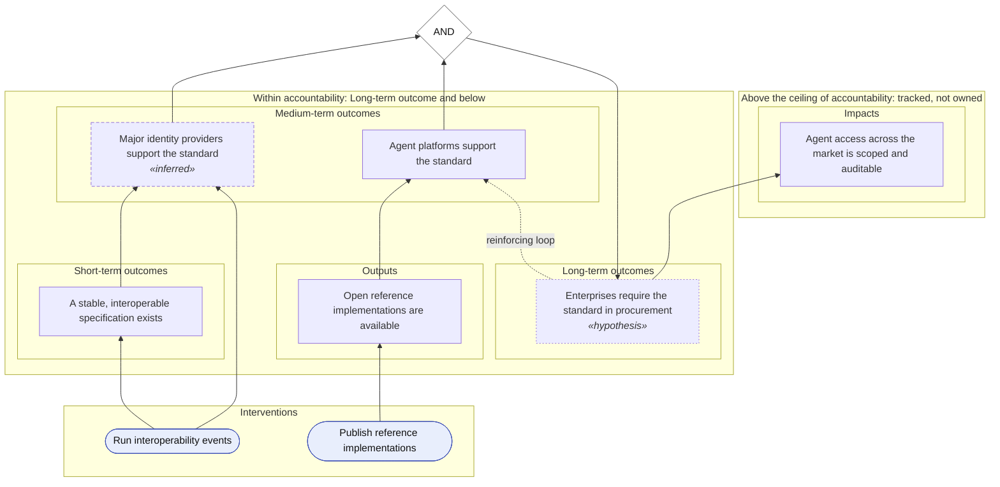

<!-- _class: lead -->

# Open agent authorization standard adoption

**Theory of Change: workshop draft**

Perspective: Standards working group · 2026-01-01 to 2028-12-31 · Status: Draft

<!--
Open by saying what this is: a draft to be corrected, not a finished plan. Anything marked inferred or hypothesis is our reading, and is yours to change.
-->

---

# The problem

AI agents act on behalf of users with credentials designed for humans, so access is over-broad and unauditable.

**Root causes we see**

- No standard way to express delegated agent authority

<!--
Ask: would you describe the problem this way? Who is missing from this description?
-->

---

# The change we are working toward

- **Agent access across the market is scoped and auditable**

**Ceiling of accountability:** Long-term outcome and below

Market-wide security outcomes depend on many actors.

<!--
Outcomes above the ceiling are tracked but not owned: we contribute to them, we do not claim them. Ask: is the line in the right place?
-->

---

# The theory of change on one page

<!--
Walk the arrows upward. Ask: is each arrow really a cause? What is missing between a box and the one above it?
-->

---

# Pathway: Supply side: providers and platforms

<!--
Ask the people who run this pathway to correct it. What do you do that is not on the page? What on the page do you not do?
-->

---

# Logic model: Supply side: providers and platforms

| Stage | Elements |
|-------|----------|
| Inputs | Two engineers and an event budget |
| Activities | Run interoperability events; Publish reference implementations |
| Outputs | Interop test suite; Event reports; Open reference implementations are available |
| Short-term outcomes | A stable, interoperable specification exists |
| Medium-term outcomes | Major identity providers support the standard _(inferred)_; Agent platforms support the standard |
| Long-term outcomes | Enterprises require the standard in procurement _(hypothesis)_ |
| Impact | Agent access across the market is scoped and auditable |

<!--
Read left to right: what goes in, what we do, what we produce, what changes. A blank row is a gap worth discussing.
-->

---

# Logic model, step by step: Supply side: providers and platforms

```mermaid
flowchart LR
  classDef activities fill:#e4f3e5,stroke:#2e7d32
  classDef impact fill:#c5cfe8,stroke:#1f3a7a
  classDef inputs fill:#fff1dc,stroke:#e08a1e
  classDef long_term fill:#d3dcee,stroke:#2c4a8a
  classDef medium_term fill:#dfe8f6,stroke:#3f5fa8
  classDef outputs fill:#ece4fb,stroke:#7e57c2
  classDef short_term fill:#e1f3fd,stroke:#2d9cdb
  classDef stage fill:transparent,stroke-width:0px
  subgraph n_inputs["Inputs"]
    n_inputs__input1["Two engineers and an event budget"]
  end
  subgraph n_activities["Activities"]
    n_activities_int_interop["Run interoperability events"]
    n_activities_int_reference["Publish reference implementations"]
  end
  subgraph n_outputs["Outputs"]
    n_outputs__output1["Interop test suite"]
    n_outputs__output2["Event reports"]
    n_outputs_oc_reference_impl["Open reference implementations are available"]
  end
  subgraph n_short_term["Short-term outcomes"]
    n_short_term_oc_spec_stable["A stable, interoperable specification exists"]
  end
  subgraph n_medium_term["Medium-term outcomes"]
    n_medium_term_oc_idp_support["Major identity providers support the standard (inferred)"]
    n_medium_term_oc_platform_support["Agent platforms support the standard"]
  end
  subgraph n_long_term["Long-term outcomes"]
    n_long_term_oc_enterprise_require["Enterprises require the standard in procurement (hypothesis)"]
  end
  subgraph n_impact["Impact"]
    n_impact_oc_safer_agents["Agent access across the market is scoped and auditable"]
  end
  n_inputs__input1 --> n_activities_int_interop
  n_activities_int_interop --> n_outputs__output1
  n_activities_int_interop --> n_outputs__output2
  n_outputs__output1 --> n_short_term_oc_spec_stable
  n_outputs__output2 --> n_short_term_oc_spec_stable
  n_outputs__output1 --> n_medium_term_oc_idp_support
  n_outputs__output2 --> n_medium_term_oc_idp_support
  n_activities_int_reference --> n_outputs_oc_reference_impl
  n_short_term_oc_spec_stable --> n_medium_term_oc_idp_support
  n_outputs_oc_reference_impl --> n_medium_term_oc_platform_support
  n_medium_term_oc_idp_support --> n_long_term_oc_enterprise_require
  n_medium_term_oc_platform_support --> n_long_term_oc_enterprise_require
  n_long_term_oc_enterprise_require --> n_impact_oc_safer_agents
  class n_inputs__input1 inputs
  class n_inputs stage
  class n_activities_int_interop activities
  class n_activities_int_reference activities
  class n_activities stage
  class n_outputs__output1 outputs
  class n_outputs__output2 outputs
  class n_outputs_oc_reference_impl outputs
  class n_outputs stage
  class n_short_term_oc_spec_stable short_term
  class n_short_term stage
  class n_medium_term_oc_idp_support medium_term
  class n_medium_term_oc_platform_support medium_term
  class n_medium_term stage
  class n_long_term_oc_enterprise_require long_term
  class n_long_term stage
  class n_impact_oc_safer_agents impact
  class n_impact stage
```

<!--
Follow one input to the change it is for. Is each arrow a thing that really leads to the next? Where does an arrow have no reason behind it?
-->

---

# What we are assuming

**Identity providers see commercial advantage in supporting agent delegation.** _(inferred)_

- If the specification is stable, then providers implement it, because customers are asking for agent controls
- To test it: Interview five providers about roadmap priorities.
- Criticality high · status Untested

**Large vendors do not fork the standard.**

- Criticality critical · status Holding

<!--
Ask: which of these do you believe least? What evidence would change your mind?
-->

---

# How we will measure

| Metric | Definition | Formula | Combines across pathways |
|--------|------------|---------|--------------------------|
| Providers with GA support | Identity providers shipping the standard in a general-availability release. | Count of distinct providers with a GA release implementing the standard. | Sum |
| Share of provider seats covered | Share of provider seats that can use the standard. | Seats at providers with GA support divided by seats at all tracked providers, weighted by seats. | Mean weighted by Providers with GA support |

<!--
Ask: could you collect this with the time you have? Is the formula what you would count?
-->

---

# Words we are using

| Term | Meaning here |
|------|--------------|
| General availability | A release available to all customers without special arrangement, as opposed to a preview. |

<!--
Agree the words before you debate the content. Which of these would your funders define differently?
-->

---

# What is established, and what is our reading

| Basis | Elements |
|-------|----------|
| Stated | 3 |
| Inferred | 2 |
| Hypothesis | 2 |
| Confirmed | 4 |
| No basis recorded | 19 |

<!--
Stated means a source says it. Inferred and hypothesis are our reading and are the first things to challenge. Confirmed means the people it concerns agreed.
-->

---

# For the room to settle

**Our reading, to confirm or correct**

- Enterprises require the standard in procurement (hypothesis)
- Major identity providers support the standard (inferred)
- Identity providers see commercial advantage in supporting agent delegation. (inferred)

<!--
Work down this list. For each: agree, change, remove, or not sure. Record what the room decides.
-->
